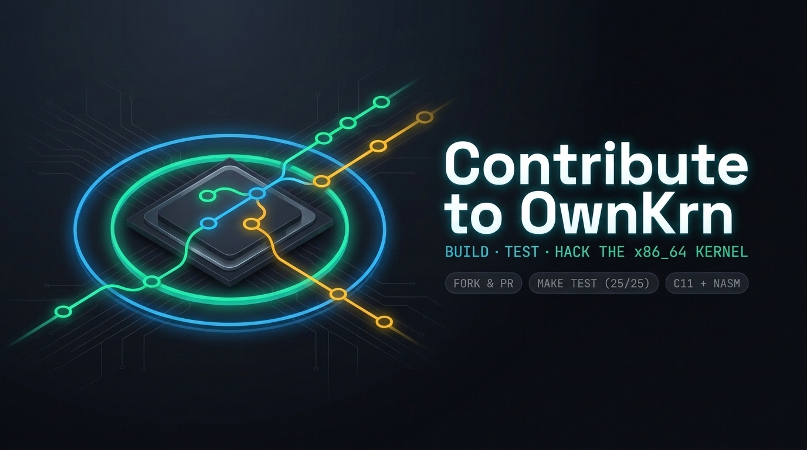

<div align="center">



<br />

# 🤝 Contributing to OwnKrn

Thank you for your interest in contributing to **OwnKrn** (`willygailo/OWN-KRN`)!
Every contribution—from low-level x86_64 drivers and syscalls to userspace utilities, bug reports, and documentation—is welcome.

<p>
  <a href="https://github.com/willygailo/OWN-KRN/issues"></a>
  <a href="https://github.com/willygailo/OWN-KRN/pulls"></a>
  <a href="https://github.com/willygailo/OWN-KRN/graphs/contributors"></a>
</p>

</div>

---

## 🛠️ Development Setup

1. **Fork & Clone** the repository:
   ```bash
   git clone https://github.com/willygailo/OWN-KRN.git
   cd OWN-KRN
   ```
2. **Verify your toolchain**:
   ```bash
   make check-tools
   ```
   Required tools: `gcc`, `ld`, `nasm`, `make`, `tar`, `qemu-system-x86_64`, `python3` (plus `gdb` for debugging and `grub-mkrescue` + `xorriso` + `mtools` for `make iso`).
3. **Create a feature branch**:
   ```bash
   git checkout -b feat/your-feature-name
   ```
4. **Build and run the full test suite**:
   ```bash
   make clean && make && make test
   ```

---

## 🧬 Kernel Engineering Guidelines

Because OwnKrn is a **freestanding higher-half x86_64 kernel**, please keep these invariants intact:

- **Zero Warnings Policy**: All kernel and Ring 3 userspace code must compile cleanly with `-Wall -Wextra -Werror`.
- **Freestanding Discipline**: Never include host libc headers in kernel or `user/` code. Use only compiler freestanding headers (`<stdint.h>`, `<stddef.h>`, `<stdbool.h>`, `<stdarg.h>`) and project headers under `include/` or `user/libc/include/`.
- **ABI & Memory Safety**:
  - Keep kernel builds on `-mno-red-zone -mno-mmx -mno-sse -mno-sse2 -mcmodel=kernel`.
  - Validate every Ring 3 pointer through `copy_from_user()` / `copy_to_user()` / `copy_str_from_user()` so bad or kernel-half pointers return `-EFAULT`.
  - Preserve **W^X** page permissions (`.text` RX, `.rodata` RO+NX, `.data`/`.bss` RW+NX).
- **CPU State Invariants**:
  - Preserve the GDT selector order (`0x08` KCODE, `0x10` KDATA, `0x18` UDATA, `0x20` UCODE) required by `SYSCALL`/`SYSRET`.
  - Maintain `swapgs` polarity (`IA32_GS_BASE = &g_cpu_local` in Ring 0; `0` in Ring 3).
- **No Stubs or Fakes**: Subsystems must run on real x86_64 structures inside QEMU and pass `make test`.

---

## 💡 Good Areas to Contribute

| Area | Ideas |
| :--- | :--- |
| 🔌 **Drivers** | VirtIO-blk / ATA PIO disk driver, framebuffer graphics console, PCI bus enumeration, RTC wall clock |
| 🗂️ **Filesystems** | `ext2` / `FAT32` driver on block devices, pipes (`pipe` + `dup2`), symbolic links |
| ⚙️ **Kernel Core** | APIC / IOAPIC + SMP multi-core bringup, copy-on-write `fork()`, POSIX signals (`kill`, `sigaction`) |
| 🐚 **Userspace** | Pipe (`\|`) support in `/bin/sh`, line editing / command history, additional `/bin/*` coreutils (`grep`, `wc`, `hexdump`) |
| 🧪 **Testing** | Additional regression cases in `tests/run_tests.sh` for fault isolation, memory stress, and edge cases |

---

## ✅ Pull Request Checklist

Before opening a pull request against `main`:

- [ ] `make clean && make` compiles with **0 warnings** and **0 errors**.
- [ ] `make test` passes all automated QEMU checks with exit code `0`.
- [ ] `build/qemu.log` contains **no** `guest_errors` or unexpected CPU resets.
- [ ] New syscalls, memory layout changes, or build targets are reflected in `README.md` and `ARCHITECTURE.md`.
- [ ] Commit messages are clear and scoped (e.g., `mm: add slab cache for small allocations`, `sh: support stdout append redirection`).

---

## 🌟 Contributors

View everyone who has contributed to OwnKrn on the [GitHub Contributors Graph](https://github.com/willygailo/OWN-KRN/graphs/contributors):

<a href="https://github.com/willygailo/OWN-KRN/graphs/contributors">
  
</a>
