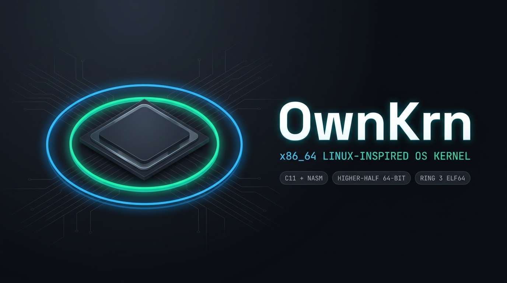
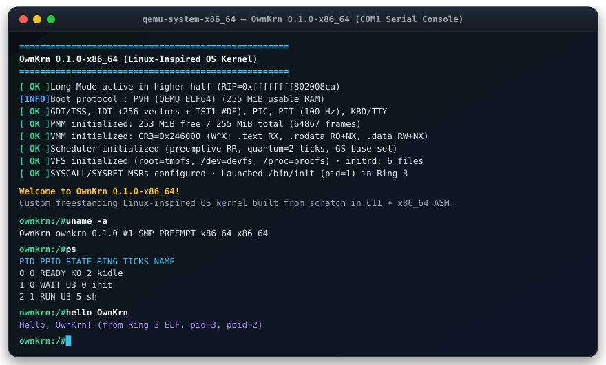
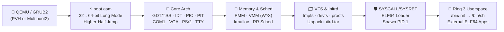

<div align="center">



<br />

# ⚡ OwnKrn `0.1.0-x86_64`

**A freestanding, higher-half, Linux-inspired 64-bit operating system kernel built completely from scratch in C11 & x86_64 NASM Assembly.**

<p>
  
  
  
  
  
</p>

<p>
  <a href="#-live-boot--shell-preview">🖥️ Live Preview</a> •
  <a href="#-core-features">✨ Features</a> •
  <a href="#-system-architecture">🏗️ Architecture</a> •
  <a href="#-memory-map">🗺️ Memory Map</a> •
  <a href="#-shell--syscalls">🐚 Shell & Syscalls</a> •
  <a href="#-quick-start">🚀 Quick Start</a> •
  <a href="#-project-layout">📂 Layout</a>
</p>

</div>

---

## 🖥️ Live Boot & Shell Preview

OwnKrn boots directly in `qemu-system-x86_64` into 64-bit Long Mode, enforces **W^X** page permissions, unpacks a POSIX `ustar` `initrd.tar`, enters **Ring 3** as PID 1 (`/bin/init`), and launches the interactive `/bin/sh` shell:

<div align="center">
  
</div>

---

## ✨ Core Features

<table>
  <tr>
    <td width="50%" valign="top">
      <h3>🚀 Higher-Half 64-Bit Bootstrap</h3>
      <ul>
        <li>Dual-boot <b>Multiboot2</b> (GRUB2 ISO) &amp; <b>QEMU PVH ELF64</b> (<code>-kernel</code>)</li>
        <li>Custom 32→64-bit Long Mode trampoline with CPUID &amp; <code>NXE</code></li>
        <li>Linked cleanly in the top 2 GiB (<code>0xFFFFFFFF80200000</code>)</li>
        <li>Zero host libc dependencies (<code>-ffreestanding -Wall -Wextra -Werror</code>)</li>
      </ul>
    </td>
    <td width="50%" valign="top">
      <h3>🧠 Memory Management &amp; W^X</h3>
      <ul>
        <li>Bitmap <b>PMM</b> initialized from bootloader E820 memory map</li>
        <li>4-level <b>VMM</b> with HHDM &amp; strict W^X (<code>.text</code> RX, <code>.rodata</code> RO+NX, <code>.data</code> RW+NX)</li>
        <li>Per-process isolated <code>CR3</code> address spaces with shared kernel heap</li>
        <li>Coalescing <code>kmalloc</code>/<code>krealloc</code>/<code>kfree</code> heap with tail overflow canaries</li>
      </ul>
    </td>
  </tr>
  <tr>
    <td width="50%" valign="top">
      <h3>⚙️ CPU Tables, IRQs &amp; Drivers</h3>
      <ul>
        <li>64-bit <b>GDT + TSS</b> (<code>RSP0</code> switching + <code>IST1</code> isolated double-fault stack)</li>
        <li>256-entry <b>IDT</b> with full register dumps &amp; <code>RBP</code> stack backtraces (<code>kpanic</code>)</li>
        <li>Remapped <b>8259 PIC</b> (vectors 32–47) &amp; <b>100 Hz PIT</b> timer</li>
        <li><b>COM1 16550 UART</b>, <b>VGA Console</b> (ANSI clear), <b>PS/2 Keyboard</b> &amp; <b>TTY</b></li>
      </ul>
    </td>
    <td width="50%" valign="top">
      <h3>🔄 Preemptive Multitasking</h3>
      <ul>
        <li>Timer-driven round-robin scheduler (<code>struct task</code>, 20 ms quantum)</li>
        <li>Assembly context switcher (<code>switch_context</code> + per-CPU <code>GS</code> base)</li>
        <li>Kernel threads, <code>sleep_ms</code>, blocking <code>waitpid</code> &amp; zombie reaping</li>
        <li>IRQ-safe spinlocks (<code>spin_lock_irqsave</code> / <code>spin_unlock_irqrestore</code>)</li>
      </ul>
    </td>
  </tr>
  <tr>
    <td width="50%" valign="top">
      <h3>🗂️ Virtual File System (VFS)</h3>
      <ul>
        <li>Unified VFS core with path normalization (<code>.</code> / <code>..</code>), mounts &amp; per-task FDs</li>
        <li>Writable in-memory <b><code>tmpfs</code></b> root filesystem (<code>/</code>)</li>
        <li>POSIX <code>ustar</code> <b><code>initrd</code></b> unpacker for <code>/bin/*</code> &amp; <code>/etc/motd</code></li>
        <li><b><code>devfs</code></b> (<code>/dev/null</code>, <code>zero</code>, <code>tty</code>, <code>serial</code>) &amp; live <b><code>procfs</code></b> (<code>/proc/tasks</code>, <code>meminfo</code>, <code>uptime</code>, <code>version</code>)</li>
      </ul>
    </td>
    <td width="50%" valign="top">
      <h3>🛡️ Ring 3 Userspace &amp; ELF64</h3>
      <ul>
        <li>Fast <code>SYSCALL</code>/<code>SYSRET</code> MSR path with <code>swapgs</code> kernel stack switching</li>
        <li><b>23 Linux-compatible x86_64 syscalls</b> (<code>fork</code>, <code>execve</code>, <code>wait4</code>, <code>brk</code>, <code>open</code>, <code>read</code>, <code>write</code>, ...)</li>
        <li>Hardened <code>copy_from_user</code>/<code>copy_to_user</code> PTE validation (<code>-EFAULT</code> on kernel ptrs)</li>
        <li>Static <b>ELF64</b> loader, freestanding <code>user/libc</code>, <code>/bin/init</code> &amp; <code>/bin/sh</code></li>
      </ul>
    </td>
  </tr>
</table>

---

## 🏗️ System Architecture

<div align="center">
  
</div>

<details>
<summary>🔀 <b>View Boot-to-Shell Execution Flow (Mermaid Diagram)</b></summary>



</details>

> [!NOTE]
> For deep-dive notes on GDT selector ordering for `SYSRET`, `swapgs` polarity invariants, and page table flags, read [ARCHITECTURE.md](ARCHITECTURE.md).

---

## 🗺️ Memory Map

| Virtual Address Range | PML4 Index | Region | Permissions |
| :--- | :---: | :--- | :---: |
| `0x0000000000000000` – `0x0000000000000FFF` | `0` | 🚫 Null Guard Page | Unmapped |
| `0x0000000000400000` – `0x00007FFFFFFFFFFF` | `0..255` | 👤 Ring 3 Userspace (ELF64 `PT_LOAD`, `brk` heap, 64 KiB stack) | `U` + W^X |
| `0xFFFF800000000000` – `0xFFFF8000FFFFFFFF`+ | `256..383` | 🪞 Higher-Half Direct Map (HHDM, 2 MiB pages) | `RW + NX` |
| `0xFFFFC00000000000` – `0xFFFFC00003FFFFFF` | `384` | 📦 Dynamic Kernel Heap (`kmalloc`, shared PDPT) | `RW + NX` |
| `0xFFFFFFFF80200000` – `__kernel_end` | `511` | 🧬 Higher-Half Kernel Image (`.text` / `.rodata` / `.data`+`.bss`) | `RX` / `RO+NX` / `RW+NX` |

---

## 🐚 Shell & Syscalls

### Built-In `/bin/sh` Commands & Ring 3 Binaries

| Category | Commands |
| :--- | :--- |
| 📁 **Filesystem** | `ls [dir]`, `cd [dir]`, `pwd`, `cat <file...>`, `echo [args...] [>\|>> file]`, `mkdir <dir>`, `touch <file>`, `rm <path>` |
| 📊 **System Info** | `uname [-a]`, `ps` (`/proc/tasks`), `free` / `mem` (`/proc/meminfo`), `uptime` (`/proc/uptime`) |
| ⚡ **External ELF64** | `hello [name]` (spawns Ring 3 ELF via `fork`+`execve`), `selftest` (runs full Ring 3 syscall & `-EFAULT` security suite) |
| 🔌 **Control** | `help`, `clear` (ANSI + VGA), `reboot`, `halt` / `poweroff`, `exit` |

<details>
<summary>📡 <b>View Linux-Compatible x86_64 Syscall Table (23 Syscalls)</b></summary>

| `#` | Syscall | `#` | Syscall | `#` | Syscall |
| :---: | :--- | :---: | :--- | :---: | :--- |
| `0` | `read` | `24` | `sched_yield` | `78` | `getdents` |
| `1` | `write` | `35` | `nanosleep` | `79` | `getcwd` |
| `2` | `open` | `39` | `getpid` | `80` | `chdir` |
| `3` | `close` | `57` | `fork` | `83` | `mkdir` |
| `4` | `stat` | `59` | `execve` | `87` | `unlink` |
| `5` | `fstat` | `60` | `exit` | `110` | `getppid` |
| `8` | `lseek` | `61` | `wait4` | `169` | `reboot` |
| `12` | `brk` | `63` | `uname` | — | — |

</details>

---

## 🚀 Quick Start

### 🔧 Prerequisites
- **Required**: `gcc`, `ld`, `nasm`, `make`, `tar`, `qemu-system-x86_64`, `python3`
- **Optional**: `gdb` (live kernel debugging), `grub-mkrescue` + `xorriso` + `mtools` (bootable ISO via `make iso`)

### ⚡ Build, Run & Verify

```bash
# 1. Verify host toolchain
make check-tools

# 2. Build kernel.elf, Ring 3 userspace ELF binaries, and initrd.tar
make

# 3. Run the 25-check automated end-to-end QEMU test suite
make test

# 4. Boot interactively in your terminal (COM1 serial)
make run
```

| Command | Description |
| :--- | :--- |
| `make` | Compiles `build/kernel.elf`, all `user/` ELF64 binaries, and `build/initrd.tar` |
| `make test` | Runs [tests/run_tests.sh](tests/run_tests.sh) (25 automated QEMU boot, VFS, Ring 3 & poweroff assertions) |
| `make run` | Boots OwnKrn interactively in headless QEMU (`-display none -serial stdio`) |
| `make run-gui` | Boots OwnKrn with graphical VGA text display + serial console |
| `make debug` | Pauses QEMU with GDB stub listening on `tcp::1234` |
| `make iso` | Builds a bootable Multiboot2 `build/kernel.iso` (requires `grub-mkrescue` + `xorriso`) |
| `make clean` | Removes `build/` artifacts |

> [!TIP]
> **Debugging OwnKrn with GDB:** Run `make debug` in Terminal 1, then attach from Terminal 2:
> ```bash
> gdb -ex 'file build/kernel.elf' -ex 'target remote :1234' -ex 'b kmain' -ex 'c'
> ```
> QEMU CPU reset & guest diagnostics are automatically logged to `build/qemu.log`.

---

## 📂 Project Layout

```text
OWN KRN/
├── ⚙️ Makefile                 # Kernel, Ring 3 userspace, initrd.tar, ISO & QEMU targets
├── 🗺️ linker/kernel.ld         # Higher-half ELF64 linker script (W^X PHDRS)
├── 🥾 boot/grub/grub.cfg       # GRUB2 Multiboot2 configuration
├── 🏗️ arch/x86_64/             # boot.asm, GDT/TSS, IDT/ISR, PIC, PIT, switch.asm, syscall.asm
├── 🧬 kernel/                  # main, panic, printk, bootinfo, sched, elf, syscall
├── 🧠 mm/                      # pmm (bitmap), vmm (4-level W^X), kmalloc (canary heap)
├── 🗂️ fs/                      # vfs, tmpfs, initrd (ustar), devfs, procfs
├── 🔌 drivers/                 # serial (COM1), console (VGA + ANSI), keyboard (PS/2), tty
├── 📚 lib/                     # Freestanding string & vsnprintf
├── 📑 include/                 # Kernel headers + shared include/uapi/syscall.h
├── 👤 user/                    # user.ld, freestanding libc, /bin/init, /bin/sh, hello, selftest
├── ✅ tests/run_tests.sh       # Automated headless QEMU end-to-end verification suite
└── 🖼️ assets/                  # Hero banner, architecture infographic & terminal preview
```

---

## 🏁 Implementation Milestones

- [x] **Phase 0** — Environment audit, higher-half `kernel.ld`, and `Makefile` build pipeline
- [x] **Phase 1** — Multiboot2/PVH 32→64-bit Long Mode bootstrap, COM1 serial, VGA console & `printk()`
- [x] **Phase 2** — 64-bit GDT/TSS (`IST1` `#DF`), 256-entry IDT, `kpanic()` backtraces, PIC, 100 Hz PIT & PS/2/UART IRQs
- [x] **Phase 3** — Bitmap PMM, 4-level W^X VMM (HHDM), and canary-protected dynamic `kmalloc` heap
- [x] **Phase 4** — Preemptive round-robin multitasking, `switch_context()`, `waitpid()`, and IRQ-safe spinlocks
- [x] **Phase 5** — VFS core, writable `tmpfs`, POSIX `ustar` `initrd`, `devfs`, `procfs`, and canonical TTY
- [x] **Phase 6** — `SYSCALL`/`SYSRET` MSR path, `copy_from/to_user` (`-EFAULT`), static ELF64 loader, `fork()` & `execve()`
- [x] **Phase 7** — Freestanding `user/libc`, PID 1 `/bin/init`, interactive `/bin/sh`, 25/25 QEMU E2E tests & documentation

---

<div align="center">

<sub>Built from scratch with ❤️ in C11 &amp; x86_64 Assembly · See <a href="ARCHITECTURE.md">ARCHITECTURE.md</a> for internals</sub>

</div>
