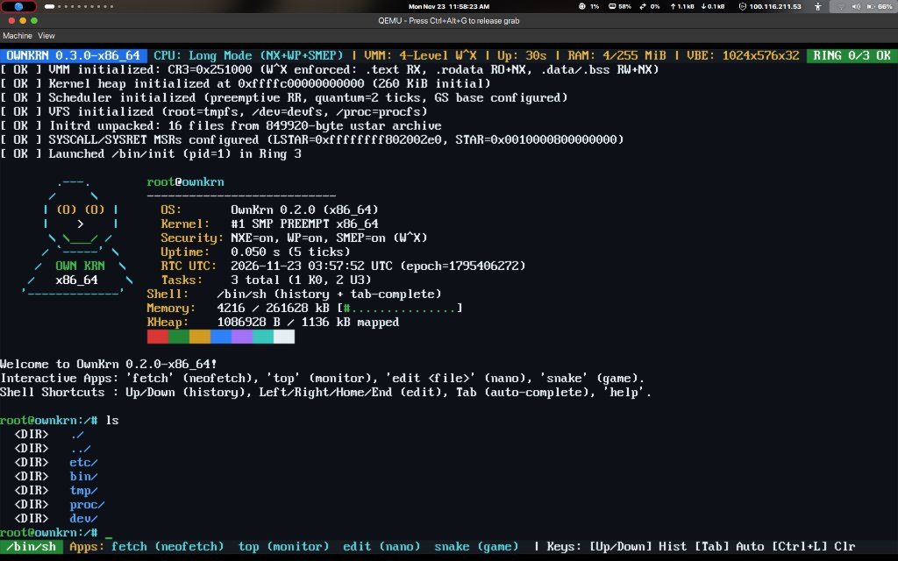
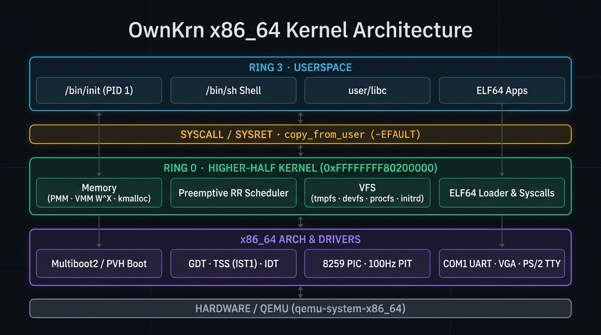
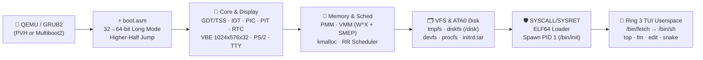

<div align="center">


<br />

# ⚡ OwnKrn `0.4.0-x86_64`

**A freestanding, higher-half, Linux-inspired 64-bit operating system kernel built completely from scratch in C11 & x86_64 NASM Assembly.**

<p>
  
  
  
  
  
  
</p>

<p>
  <a href="#-live-boot--shell-preview">🖥️ Live Preview</a> •
  <a href="#-core-features">✨ Features</a> •
  <a href="#-system-architecture">🏗️ Architecture</a> •
  <a href="#-memory-map">🗺️ Memory Map</a> •
  <a href="#-shell--syscalls">🐚 Shell & Syscalls</a> •
  <a href="#-quick-start-linux-macos-windows--docker">🚀 Quick Start</a> •
  <a href="#-project-layout">📂 Layout</a> •
  <a href="#-contributing--contributors">🤝 Contributing</a>
</p>

</div>

---

## 🖥️ Live Boot & Shell Preview

OwnKrn boots directly in `qemu-system-x86_64` into 64-bit Long Mode, initializes a **16:9 Widescreen 32-Bit Linear Framebuffer (`1024×576×32`, `128×36` grid)** with a live 1 Hz Top OS HUD Bar and Bottom App Dock, mounts a persistent **ATA0 28-bit LBA hard disk at `/disk`**, enters **Ring 3** as PID 1 (`/bin/init`), and launches `/bin/fetch` + the interactive `/bin/sh` shell:

<div align="center">
  
</div>

---

## ✨ Core Features

<table>
  <tr>
    <td width="50%" valign="top">
      <h3>🚀 Higher-Half 64-Bit &amp; Cross-Platform</h3>
      <ul>
        <li>Dual-boot <b>Multiboot2</b> (GRUB2 ISO) &amp; <b>QEMU PVH ELF64</b> (<code>-kernel</code>)</li>
        <li>Custom 32→64-bit Long Mode trampoline with CPUID &amp; <code>NXE</code></li>
        <li>Linked cleanly in the top 2 GiB (<code>0xFFFFFFFF80200000</code>)</li>
        <li>Builds &amp; runs on <b>Linux</b>, <b>macOS</b> (Intel/Apple Silicon), <b>Windows</b> &amp; <b>Docker</b></li>
      </ul>
    </td>
    <td width="50%" valign="top">
      <h3>🧠 Memory Management &amp; W^X</h3>
      <ul>
        <li>Bitmap <b>PMM</b> initialized from bootloader E820 memory map</li>
        <li>4-level <b>VMM</b> with HHDM &amp; strict W^X (<code>.text</code> RX, <code>.rodata</code> RO+NX, <code>.data</code> RW+NX)</li>
        <li>Per-process isolated <code>CR3</code> address spaces with shared kernel heap</li>
        <li>Coalescing <code>kmalloc</code>/<code>krealloc</code>/<code>kfree</code> heap with tail overflow canaries</li>
      </ul>
    </td>
  </tr>
  <tr>
    <td width="50%" valign="top">
      <h3>⚙️ CPU, Widescreen VBE &amp; Hardware Drivers</h3>
      <ul>
        <li>Hardware hardening: <code>NXE</code>, <code>CR0.WP</code> &amp; <b><code>CR4.SMEP</code></b> enabled at boot</li>
        <li><b>Bochs VBE 32-Bit Linear Framebuffer</b> (<code>1024×576×32</code>, <code>128×36</code> grid, 8×16 font &amp; live 1 Hz Top HUD Bar)</li>
        <li><b>PCI Bus Enumeration</b> (<code>lspci</code>), <b>ATA0 28-bit LBA PIO Disk</b> (<code>lsblk</code>), <b>PIT Ch2 PC Speaker</b>, <b>100 Hz PIT</b> &amp; <b>CMOS RTC</b></li>
        <li><b>COM1 UART</b>, <b>COM2 Host Clipboard Bridge</b> (<code>/dev/clipboard</code>), <b>PS/2 Extended Keyboard</b> &amp; <b>16 KiB TTY</b></li>
      </ul>
    </td>
    <td width="50%" valign="top">
      <h3>🔄 Preemptive Multitasking &amp; Signals</h3>
      <ul>
        <li>Timer-driven round-robin scheduler (<code>struct task</code>, 20 ms quantum)</li>
        <li>Assembly context switcher (<code>switch_context</code> + per-CPU <code>GS</code> base)</li>
        <li>POSIX signals (<code>SIGINT</code> via <code>Ctrl+C</code>, <code>SIGTERM</code>, <code>SIGKILL</code>, <code>SIGPIPE</code>)</li>
        <li>PID 1 orphan reaper, <code>WNOHANG</code>, Ring 3 fault containment &amp; IRQ-safe spinlocks</li>
      </ul>
    </td>
  </tr>
  <tr>
    <td width="50%" valign="top">
      <h3>🗂️ VFS, Persistent <code>/disk</code> &amp; Unix IPC</h3>
      <ul>
        <li>Refcounted VFS core (atomic <code>rename</code>, <code>chmod</code>, multi-user <code>UID</code>/<code>GID</code> checks), <b><code>tmpfs</code></b> &amp; <code>ustar</code> <b><code>initrd</code></b></li>
        <li>Persistent <b><code>diskfs</code></b> mounted at <code>/disk</code> (backed by <code>build/disk.img</code> across reboots)</li>
        <li>Kernel ring-buffer <b>Unix Pipes</b> (<code>pipe</code>, <code>dup</code>, <code>dup2</code>) with EOF &amp; <code>SIGPIPE</code></li>
        <li><b><code>devfs</code></b> (<code>null</code>, <code>zero</code>, <code>tty</code>, <code>serial</code>, <code>urandom</code>, <code>speaker</code>, <code>clipboard</code>) &amp; <b><code>procfs</code></b> (<code>kmsg</code>, <code>pci</code>, <code>partitions</code>, <code>config</code>, <code>tasks</code>, <code>meminfo</code>, <code>cpuinfo</code>, <code>interrupts</code>, <code>mounts</code>, <code>uptime</code>, <code>rtc</code>, <code>version</code>)</li>
      </ul>
    </td>
    <td width="50%" valign="top">
      <h3>🛡️ Ring 3 Userspace &amp; TUI Code Studio</h3>
      <ul>
        <li>Fast <code>SYSCALL</code>/<code>SYSRET</code> MSR path with <code>swapgs</code> kernel stack switching</li>
        <li><b>39 Linux-compatible x86_64 syscalls</b> (<code>mmap</code>, <code>munmap</code>, <code>chmod</code>, <code>getuid</code>/<code>setuid</code>, <code>fork</code>, <code>execve</code>, <code>ioctl</code>, <code>rename</code>, <code>pipe</code>, <code>dup2</code>, <code>kill</code>, ...)</li>
        <li>Hardened <code>copy_from_user</code>/<code>copy_to_user</code> PTE validation (<code>-EFAULT</code> on kernel ptrs)</li>
        <li><b>OwnKrn Code Studio</b> (<code>code</code> / <code>nano</code> / <code>edit</code> / <code>micro</code>) with live <code>.py</code>/<code>.sh</code>/<code>.c</code>/<code>.txt</code> syntax highlighting, smart auto-indent, <code>Ctrl+Shift+V</code>/<code>Ctrl+V</code> Host Copy-Paste, <code>Ctrl+T</code> templates &amp; <code>Ctrl+R</code> instant Save &amp; Run + Mini-Python 3.x runner</li>
      </ul>
    </td>
  </tr>
</table>

---

## 🏗️ System Architecture

<div align="center">
  
</div>

<details>
<summary>🔀 <b>View Boot-to-Shell Execution Flow (Mermaid Diagram)</b></summary>



</details>

> [!NOTE]
> For deep-dive notes on GDT selector ordering for `SYSRET`, `swapgs` polarity invariants, and page table flags, read [ARCHITECTURE.md](ARCHITECTURE.md).

---

## 🗺️ Memory Map

| Virtual Address Range | PML4 Index | Region | Permissions |
| :--- | :---: | :--- | :---: |
| `0x0000000000000000` – `0x0000000000000FFF` | `0` | 🚫 Null Guard Page | Unmapped |
| `0x0000000000400000` – `0x00007FFFFFFFFFFF` | `0..255` | 👤 Ring 3 Userspace (ELF64 `PT_LOAD`, `brk` heap, 64 KiB stack) | `U` + W^X |
| `0xFFFF800000000000` – `0xFFFF8000FFFFFFFF`+ | `256..383` | 🪞 Higher-Half Direct Map (HHDM, 2 MiB pages) | `RW + NX` |
| `0xFFFFC00000000000` – `0xFFFFC00003FFFFFF` | `384` | 📦 Dynamic Kernel Heap (`kmalloc`, shared PDPT) | `RW + NX` |
| `0xFFFFFFFF80200000` – `__kernel_end` | `511` | 🧬 Higher-Half Kernel Image (`.text` / `.rodata` / `.data`+`.bss`) | `RX` / `RO+NX` / `RW+NX` |

---

## 🐚 Shell & Syscalls

### Built-In `/bin/sh` Commands & Ring 3 Binaries

| Category | Commands |
| :--- | :--- |
| 🐧 **Linux Kernel & Kconfig** | `dmesg [-c]` (`[    0.000000]` kernel ring buffer `/proc/kmsg`), `lspci` (`/proc/pci`), `lsblk` (`/proc/partitions`), `kconfig` (`/proc/config`), plus `make defconfig` & interactive `make menuconfig` |
| 🧪 **Diagnostics & Benchmark** | `tester` / `bench` / `diag` / `memtest` (interactive 6-suite TUI testbench; `tester -b` batch mode; auto-exports report to `/disk/test_report.txt`) |
| 💻 **TUI Code Studio & Python** | `code <file>` / `nano` / `edit` / `micro` / `vim` (live `.py`/`.sh`/`.c`/`.txt` syntax highlighting, smart auto-indent, `Ctrl+Shift+V`/`Ctrl+V` Host Paste, `Ctrl+C` Copy, `Ctrl+A` Select All, `Ctrl+Z` Undo, `Ctrl+T` Starter Template, `Ctrl+R` Instant Save & Run, `Ctrl+F` Find), plus `python` / `python3 <script.py>` Mini-Python 3.x runner & `clip` / `paste` (`/dev/clipboard`) |
| 🖥️ **Interactive TUI Apps** | `fetch` / `neofetch` (ASCII OS logo & live telemetry), `top` / `htop` (real-time task & memory monitor with `[k]` kill), `fm [dir]` (dual-pane file manager), `snake` (playable arcade game) |
| 💾 **Persistent Disk (`/disk`)** | Backed by `drivers/ata.c` (28-bit LBA PIO on `build/disk.img`): `df` / `mounts` (`/proc/mounts`), `sync`, plus persistent file read/write in `/disk/*` that survives OS reboots |
| ⌨️ **Bash-Like Shell & Jobs** | `$VAR` / `$?` / `$$` / `~` expansion, `export KEY=VAL`, `unset`, `env`, `;` and `&&` chaining, background jobs (`cmd &`, `jobs`, `fg`), **Up/Down** history, **Tab** completion |
| 👤 **Users & Permissions** | `id` (`uid`/`gid`), `su [root\|guest]` (multi-user credential switch), `chmod <octal> <path>`, `/etc/passwd`, `/etc/group`, `/etc/os-release` |
| 📁 **Filesystem & Coreutils** | `ls [-l] [dir]` / `ll`, `tree [dir]`, `find [dir] [-name pat]`, `sort`, `uniq`, `which`, `stat`, `cp`, `mv`, `head`, `tail`, `sh <script.sh>`, `cd`, `pwd`, `cat`, `mkdir`, `touch`, `rm` |
| 🧮 **Utilities & Audio** | `calc <a op b>` (dec/hex arithmetic & bitwise calculator), `cal [month] [year]` (monthly calendar with RTC highlight), `beep [hz] [ms]` (PIT Ch2 PC Speaker audio via `/dev/speaker`) |
| 🔀 **Pipelines & I/O** | Full multi-stage pipelines (`ps \| grep U3`, `cat /etc/motd \| wc`) + `<`, `>`, `>>` for both built-ins & ELF64 binaries |
| 📊 **System & Hardware Info** | `uname [-a\|-r\|-s\|-m]`, `cpuinfo` (`/proc/cpuinfo`), `irqs` (`/proc/interrupts`), `ps` (`/proc/tasks`), `free` (`/proc/meminfo`), `uptime` (`/proc/uptime`), `date` (`/proc/rtc`) |
| ⚡ **Ring 3 ELF64 Apps** | `tester`, `fetch`, `top`, `fm`, `edit`, `snake`, `hello [name]`, `grep <pat> [file]`, `wc [file]`, `hexdump [file]`, `date`, `sleep <ms>`, `selftest`, `faulttest` |
| 🔌 **Control** | `help`, `kill <pid> [sig]`, `clear` (ANSI + VBE LFB), `reboot`, `halt` / `poweroff`, `exit` |

<details>
<summary>📡 <b>View Linux-Compatible x86_64 Syscall Table (39 Syscalls)</b></summary>

| `#` | Syscall | `#` | Syscall | `#` | Syscall | `#` | Syscall |
| :---: | :--- | :---: | :--- | :---: | :--- | :---: | :--- |
| `0` | `read` | `16` | `ioctl` | `60` | `exit` | `90` | `chmod` |
| `1` | `write` | `22` | `pipe` | `61` | `wait4` | `102` | `getuid` |
| `2` | `open` | `24` | `sched_yield` | `62` | `kill` | `104` | `getgid` |
| `3` | `close` | `32` | `dup` | `63` | `uname` | `105` | `setuid` |
| `4` | `stat` | `33` | `dup2` | `78` | `getdents` | `106` | `setgid` |
| `5` | `fstat` | `35` | `nanosleep` | `79` | `getcwd` | `107` | `geteuid` |
| `8` | `lseek` | `39` | `getpid` | `80` | `chdir` | `108` | `getegid` |
| `9` | `mmap` | `57` | `fork` | `82` | `rename` | `110` | `getppid` |
| `11` | `munmap` | `59` | `execve` | `83` | `mkdir` | `169` | `reboot` |
| `12` | `brk` | — | — | `87` | `unlink` | `228` | `clock_gettime` |

</details>

---

## 🚀 Quick Start (Linux, macOS, Windows & Docker)

OwnKrn's build system ([Makefile](Makefile), [scripts/mkimg.py](scripts/mkimg.py), and [tests/run_tests.py](tests/run_tests.py)) auto-detects your host OS, cross-compiler (`x86_64-elf-gcc`, `x86_64-linux-gnu-gcc`, `gcc`, or `clang`), and QEMU display backend (`gtk` on Linux, `cocoa` on macOS, `sdl`/`gtk` on Windows).

### 🐧 Linux (Ubuntu / Debian / Fedora / Arch)

```bash
# 1. Install toolchain & QEMU automatically
bash ./scripts/setup.sh

# 2. Build, run 79 automated QEMU tests, and launch the Widescreen GUI (with Host Clipboard Bridge)
make && make test
make run-gui
```

### 🍎 macOS (Intel & Apple Silicon M1–M4)

```bash
# 1. Install Homebrew x86_64-elf cross-compiler, NASM & QEMU
bash ./scripts/setup.sh
# (or manually: brew install x86_64-elf-gcc x86_64-elf-binutils nasm qemu python3 make)

# 2. Build, test & launch native macOS Cocoa QEMU GUI
make && make test
make run-gui
```

### 🪟 Windows 10 / 11 (PowerShell, CMD, MSYS2 or WSL2)

```powershell
# Option A: PowerShell one-command launcher (supports WSL2, MSYS2, or Docker)
.\scripts\build.ps1 setup
.\scripts\build.ps1 test
.\scripts\build.ps1 run-gui

# Option B: Command Prompt (CMD)
scripts\build.bat run-gui

# Option C: Inside MSYS2 UCRT64 shell
pacman -S make mingw-w64-ucrt-x86_64-nasm mingw-w64-ucrt-x86_64-qemu mingw-w64-ucrt-x86_64-python mingw-w64-ucrt-x86_64-x86_64-elf-gcc
make && make run-gui
```

### 🐳 Docker (Zero-Install on Any OS)

```bash
docker build -t ownkrn .
docker run --rm -it ownkrn
```

| Command | Description |
| :--- | :--- |
| `make` | Compiles `build/kernel.elf`, all `user/` ELF64 binaries, `build/initrd.tar`, and 4 MiB `build/disk.img` |
| `make defconfig` | Generates `.config` and `include/generated/autoconf.h` from `configs/x86_64_defconfig` |
| `make menuconfig` | Launches the interactive Linux-style `Kconfig` curses configuration menu |
| `make test` | Runs [tests/run_tests.py](tests/run_tests.py) (79 cross-platform automated QEMU assertions) |
| `make run` | Boots OwnKrn interactively in headless terminal mode (`-display none -serial stdio` + COM2 clipboard bridge) |
| `make run-gui` | Boots OwnKrn in 16:9 Widescreen `1024×576×32` VBE GUI mode (`gtk` / `cocoa` / `sdl` + `usb-tablet` + COM2 Host Clipboard Bridge) |
| `make debug` | Pauses QEMU with GDB stub listening on `tcp::1234` |
| `make iso` | Builds a bootable Multiboot2 `build/kernel.iso` (requires `grub-mkrescue` + `xorriso`) |
| `make clean` | Removes `build/` artifacts |

> [!TIP]
> **Debugging OwnKrn with GDB:** Run `make debug` in Terminal 1, then attach from Terminal 2:
> ```bash
> gdb -ex 'file build/kernel.elf' -ex 'target remote :1234' -ex 'b kmain' -ex 'c'
> ```
> QEMU CPU reset & guest diagnostics are automatically logged to `build/qemu.log`.

---

## 📂 Project Layout

```text
OWN KRN/
├── ⚙️ Makefile                 # Cross-platform build (Linux, macOS, Windows), Kconfig, initrd, disk.img & QEMU
├── 🐧 Kconfig                  # Linux-style kernel configuration schema (configs/x86_64_defconfig)
├── 🐳 Dockerfile               # Reproducible zero-setup container build & test runner
├── 🛠️ scripts/                 # setup.sh, build.ps1, build.bat, mkimg.py, kconfig.py, clipboard_bridge.py
├── 🗺️ linker/kernel.ld         # Higher-half ELF64 linker script (W^X PHDRS)
├── 🥾 boot/grub/grub.cfg       # GRUB2 Multiboot2 ISO configuration
├── 🏗️ arch/x86_64/             # boot.asm, GDT/TSS, IDT/ISR, PIC, PIT, switch.asm, syscall.asm
├── 🧬 kernel/                  # main, panic, printk (16 KiB dmesg ring), bootinfo, sched, elf, syscall
├── 🧠 mm/                      # pmm (bitmap), vmm (4-level W^X + mmap), kmalloc (canary heap)
├── 🗂️ fs/                      # vfs, tmpfs, diskfs (ATA0 /disk), pipe, initrd (ustar), devfs (/dev/clipboard), procfs
├── 🔌 drivers/                 # console (VBE 1024x576x32 + HUD), pci, ata (PIO LBA), speaker, rtc, keyboard, tty, serial (COM1/COM2)
├── 📚 lib/                     # Freestanding string & vsnprintf
├── 📑 include/                 # Kernel headers, font8x16.h & shared include/uapi/syscall.h
├── 👤 user/                    # user.ld, libc, init, sh (Python runner + jobs), tester, fetch, top, fm, edit (Code Studio), snake
├── ✅ tests/                   # run_tests.py (79-check threaded cross-platform runner) & run_tests.sh
└── 🖼️ assets/                  # Hero banner, architecture diagram & widescreen-gui.jpg preview
```

---

## 🏁 Implementation Milestones

- [x] **Phase 0** — Environment audit, higher-half `kernel.ld`, and `Makefile` build pipeline
- [x] **Phase 1** — Multiboot2/PVH 32→64-bit Long Mode bootstrap, COM1 serial, VGA console & `printk()`
- [x] **Phase 2** — 64-bit GDT/TSS (`IST1` `#DF`), 256-entry IDT, `kpanic()` backtraces, PIC, 100 Hz PIT & PS/2/UART IRQs
- [x] **Phase 3** — Bitmap PMM, 4-level W^X VMM (HHDM), and canary-protected dynamic `kmalloc` heap
- [x] **Phase 4** — Preemptive round-robin multitasking, `switch_context()`, `waitpid()`, and IRQ-safe spinlocks
- [x] **Phase 5** — VFS core, writable `tmpfs`, POSIX `ustar` `initrd`, `devfs`, `procfs`, and canonical TTY
- [x] **Phase 6** — `SYSCALL`/`SYSRET` MSR path, `copy_from/to_user` (`-EFAULT`), static ELF64 loader, `fork()` & `execve()`
- [x] **Phase 7** — Freestanding `user/libc`, PID 1 `/bin/init`, interactive `/bin/sh`, automated QEMU E2E tests & documentation
- [x] **v0.2.0 Hardening & Unix IPC** — Refcounted VFS/tmpfs, `CR4.SMEP`, CMOS RTC (`date`), `pipe`/`dup`/`dup2` + shell pipelines (`|`, `<`, `>`, `>>`), POSIX `kill`/`SIGINT`, Ring 3 fault containment, `grep`/`wc`/`hexdump`/`sleep` & GitHub Actions CI (32/32 tests passing)
- [x] **v0.3.0 Widescreen VBE GUI, Persistent `/disk`, TUI Suite & Cross-Platform Support** — Bochs VBE `1024×576×32` linear framebuffer (`128×36` grid + live 1 Hz Top HUD Bar & Bottom Dock), ATA0 28-bit LBA persistent `/disk` (`diskfs`), PIT Ch2 PC Speaker (`beep`), raw/non-blocking `SYS_ioctl` TTY, `SYS_rename` (`mv`/`cp`), shell line editing (arrow history + tab completion + scripts), `fetch`/`top`/`fm`/`edit`/`snake`/`calc`/`cal`, `/dev/urandom`, `/proc/cpuinfo`/`interrupts`/`mounts`, and Linux/macOS/Windows/Docker support (54/54 tests passing)
- [x] **v0.4.0 `torvalds/linux`-Style Kconfig, `dmesg`, PCI Bus, `mmap`, Multi-User `UID`/`GID`, TUI Code Studio & Host Clipboard Bridge** — `Kconfig`/`.config` + `make defconfig` & interactive `make menuconfig` + `/proc/config`, 16 KiB `[    0.000000]` `dmesg` ring buffer (`/proc/kmsg`), PCI Bus hardware enumeration (`lspci`, `/proc/pci`) & block partition table (`lsblk`, `/proc/partitions`), `SYS_mmap`/`SYS_munmap`, multi-user `UID`/`GID` credentials (`id`, `su root/guest`, `chmod`) + Linux FHS (`/etc/os-release`, `/etc/passwd`), `$VAR`/`$?` expansion + `;`/`&&` chaining + background jobs (`&`, `jobs`, `fg`), `find`/`sort`/`uniq`/`which`, COM2 Host-to-GUI Clipboard Bridge (`/dev/clipboard`, `clip`/`paste`, `scripts/clipboard_bridge.py`), OwnKrn TUI Code Studio (`code`/`nano`/`edit`/`micro` with `.py`/`.sh`/`.c`/`.txt` syntax highlighting, auto-indent, `Ctrl+Shift+V`/`Ctrl+V` Paste, `Ctrl+T` Templates & `Ctrl+R` Save & Run + Mini-Python 3.x runner), and 6-suite `/bin/tester` testbench (79/79 tests passing)

---

## 🤝 Contributing & Contributors

Contributions are always welcome! Read [CONTRIBUTING.md](CONTRIBUTING.md) for toolchain setup, kernel invariants (`W^X`, `-EFAULT`, `swapgs`), and the PR checklist.

<div align="center">
  <a href="CONTRIBUTING.md">
    
  </a>
  <br />
  <br />
  <a href="https://github.com/willygailo/OWN-KRN/graphs/contributors">
    
  </a>
  <br />
  <br />
  <a href="https://github.com/willygailo/OWN-KRN/graphs/contributors">📊 View Full Contributors Graph</a> •
  <a href="CONTRIBUTING.md">📖 Contributing Guide</a> •
  <a href="https://github.com/willygailo/OWN-KRN/issues">🐛 Report an Issue</a> •
  <a href="https://github.com/willygailo/OWN-KRN/pulls">🚀 Open a Pull Request</a>
</div>

---

<div align="center">

<sub>Built from scratch with ❤️ in C11 &amp; x86_64 Assembly · See <a href="ARCHITECTURE.md">ARCHITECTURE.md</a> for internals</sub>

</div>
